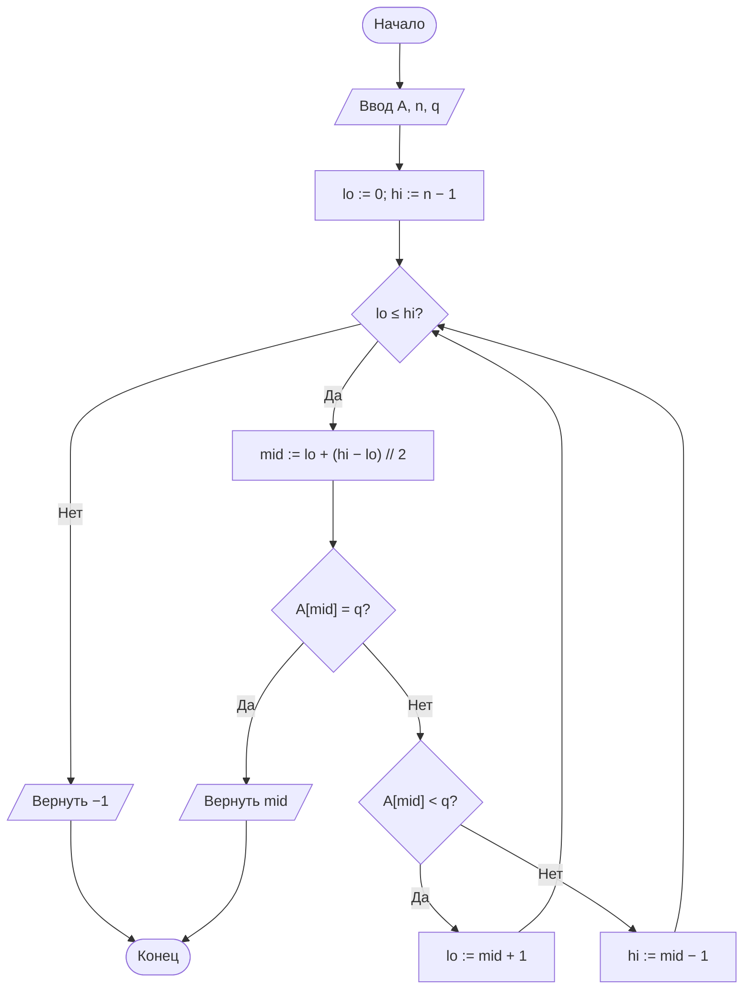
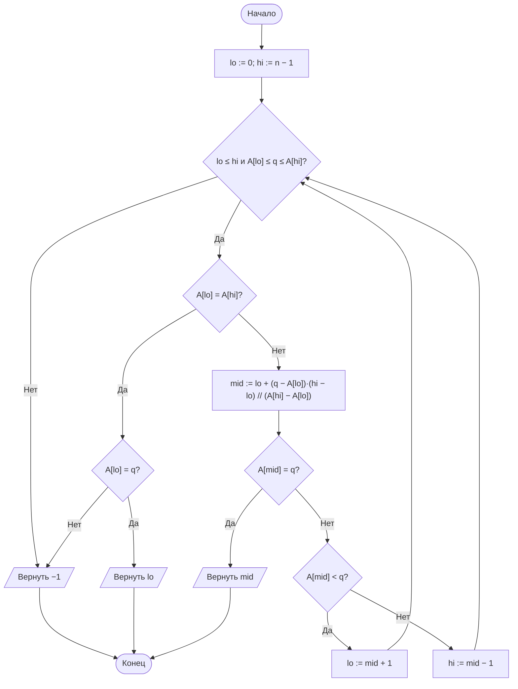

# Лабораторная работа № 4

## Анализ алгоритмов последовательного, двоичного и интерполяционного поиска

**Дисциплина:** Теория алгоритмов
**Направление подготовки:** 38.03.05 «Бизнес-информатика»
**Курс:** 2
**Объём:** 4 академических часа
**Язык реализации:** Python 3.10+
**Предварительные требования:** ЛР № 2, № 3 (модуль `sorts_common.py`, методика замера времени)

---

## 1. Цель и задачи работы

**Цель работы:** изучить алгоритмы поиска элемента в массиве, экспериментально сопоставить их трудоёмкость с теоретическими оценками и определить условия, при которых предварительная сортировка данных оправдана.

**Задачи:**

1. Изучить постановку задачи поиска и оценки сложности последовательного, двоичного и интерполяционного поиска.
2. Реализовать три алгоритма поиска с подсчётом числа сравнений.
3. Измерить среднее время одного запроса при различных размерах массива.
4. Определить число запросов, начиная с которого предварительная сортировка массива окупается.
5. Исследовать зависимость эффективности интерполяционного поиска от распределения ключей.

---

## 2. Теоретическая часть

### 2.1. Постановка задачи

Дан массив $A$ из $n$ элементов и ключ $q$. Требуется определить индекс $i$, для которого $A[i] = q$, либо установить, что такого элемента нет. Различают:

- **успешный поиск** — искомый ключ присутствует в массиве;
- **неуспешный поиск** — ключ отсутствует.

Неуспешный поиск, как правило, требует больше операций и потому важен при оценке худшего случая.

### 2.2. Последовательный (линейный) поиск

Элементы просматриваются подряд до совпадения либо до конца массива. Алгоритм не требует упорядоченности данных.

Число сравнений при успешном поиске с равновероятным расположением ключа:

$$C_{\text{ср}} = \frac{1 + 2 + \ldots + n}{n} = \frac{n + 1}{2} = \Theta(n).$$

При неуспешном поиске всегда выполняется $n$ сравнений.

**Модификация с барьером.** В конец массива записывается искомый ключ. Тогда цикл гарантированно завершится, и проверка выхода за границу массива становится излишней. Число сравнений в цикле сокращается примерно вдвое, хотя асимптотика остаётся $\Theta(n)$. Приём подробно описан у Н. Вирта [1].

### 2.3. Двоичный поиск

Применим только к **упорядоченному** массиву. Рассматривается средний элемент отрезка; в зависимости от результата сравнения поиск продолжается в левой или правой половине.

После каждого сравнения длина рассматриваемого отрезка уменьшается вдвое, поэтому число сравнений в худшем случае

$$C_{\max} = \lfloor \log_2 n \rfloor + 1 = \Theta(\log n).$$

Для $n = 10^6$ достаточно 20 сравнений против 500 000 в среднем у последовательного поиска.

**Типичные ошибки реализации:**

- переполнение при вычислении середины как $(lo + hi)/2$ (для Python несущественно, для языков с ограниченной разрядностью критично; безопасная форма $lo + (hi - lo)/2$);
- неверные границы цикла, приводящие к зацикливанию или пропуску элемента;
- применение к неотсортированному массиву, что даёт неверный результат без каких-либо сообщений об ошибке.

### 2.4. Интерполяционный поиск

Вместо середины отрезка вычисляется **ожидаемая** позиция ключа в предположении, что значения распределены равномерно:

$$mid = lo + \left\lfloor \frac{(q - A[lo]) \cdot (hi - lo)}{A[hi] - A[lo]} \right\rfloor.$$

Так человек ищет фамилию в телефонном справочнике: на букву «А» открывает начало, а не середину.

**Оценки сложности:**

| Условие | Число сравнений |
|---|---|
| Равномерное распределение ключей | $O(\log \log n)$ |
| Произвольное (например, степенное) распределение | до $O(n)$ |

Для $n = 10^6$ оценка $\log_2 \log_2 n \approx 4{,}3$. Выигрыш по числу сравнений относительно двоичного поиска значителен, однако каждое сравнение дороже: оно требует умножения и деления. Поэтому на практике выигрыш во времени проявляется лишь на больших массивах с равномерными ключами.

### 2.5. Окупаемость предварительной сортировки

Пусть требуется обработать $k$ запросов к массиву из $n$ элементов. Сравним две стратегии:

$$T_{\text{без сортировки}} = k \cdot c_1 n, \qquad T_{\text{с сортировкой}} = c_2 n \log_2 n + k \cdot c_3 \log_2 n,$$

где $c_1, c_2, c_3$ — константы реализации. Сортировка окупается при

$$k > \frac{c_2 \, n \log_2 n}{c_1 n - c_3 \log_2 n} \approx \frac{c_2}{c_1} \log_2 n.$$

Таким образом, **порог окупаемости растёт очень медленно** — логарифмически. Уже при нескольких десятках запросов к массиву из миллиона элементов сортировка оправдана. Этот вывод лежит в основе устройства индексов в базах данных.

### 2.6. Сводная таблица

| Алгоритм | Упорядоченность | Лучший | Средний | Худший | Доп. память |
|---|---|---|---|---|---|
| Последовательный | Не требуется | $\Theta(1)$ | $\Theta(n)$ | $\Theta(n)$ | $O(1)$ |
| Двоичный | Требуется | $\Theta(1)$ | $\Theta(\log n)$ | $\Theta(\log n)$ | $O(1)$ |
| Интерполяционный | Требуется | $\Theta(1)$ | $\Theta(\log \log n)$\* | $\Theta(n)$ | $O(1)$ |

\* При равномерном распределении ключей.

---

## 3. Порядок выполнения работы

1. Изучить теоретическую часть.
2. Построить блок-схемы трёх алгоритмов поиска.
3. Реализовать алгоритмы. Каждая функция возвращает пару «индекс (или −1), число сравнений».
4. Сгенерировать массив согласно варианту (табл. 1, 2) и набор запросов.
5. Измерить **среднее время одного запроса**: суммарное время серии запросов делится на их число. Отдельный запрос слишком быстр для прямого измерения.
6. Построить графики зависимости среднего времени и числа сравнений от $n$ (шкала по оси абсцисс логарифмическая).
7. Экспериментально определить точку окупаемости сортировки.
8. Выполнить дополнительное задание и оформить отчёт.

---

## 4. Варианты заданий

**Таблица 1. Распределение ключей**

| Код | Распределение | Способ получения |
|---|---|---|
| Р | Равномерное | Случайные целые из диапазона $[0;\ 10n]$ |
| К | Кластеризованное | 90 % ключей из $[0;\ n]$, 10 % из $[10^6;\ 10^7]$ |
| С | Степенное | $\lfloor 10^6 \cdot u^3 \rfloor$, где $u$ равномерно на $[0; 1)$ |
| А | Арифметическая прогрессия | $A[i] = c + d \cdot i$ (идеальный случай для интерполяции) |

**Таблица 2. Исходные данные**

| № | Размеры массива $n$ | Распределение | Запросов $k$ | Тип запросов | Доп. |
|---|---|---|---|---|---|
| 0 | $10^3$, $10^4$, $10^5$, $10^6$ | Р | 1000 | успешные | — |
| 1 | $10^3$, $10^4$, $10^5$ | Р | 500 | неуспешные | Б1 |
| 2 | $2 \cdot 10^3 \ldots 10^6$ (4 точки) | К | 1000 | успешные | Б2 |
| 3 | $10^4$, $10^5$, $10^6$ | С | 2000 | смешанные (50/50) | Б3 |
| 4 | $10^3$, $5 \cdot 10^3$, $10^4$, $10^5$ | А | 1000 | успешные | Б4 |
| 5 | $10^4 \ldots 10^6$ (5 точек) | Р | 5000 | неуспешные | Б5 |
| 6 | $10^3$, $10^4$, $10^5$ | К | 1000 | смешанные | Б6 |
| 7 | $5 \cdot 10^3$, $5 \cdot 10^4$, $5 \cdot 10^5$ | Р | 2000 | успешные | Б7 |
| 8 | $10^3 \ldots 10^6$ (4 точки) | С | 1000 | успешные | Б1 |
| 9 | $10^4$, $10^5$, $10^6$ | А | 3000 | неуспешные | Б2 |
| 10 | $2 \cdot 10^4$, $2 \cdot 10^5$, $2 \cdot 10^6$ | Р | 1000 | смешанные | Б3 |
| 11 | $10^3$, $10^4$, $10^5$ | К | 500 | успешные | Б4 |
| 12 | $10^4 \ldots 10^6$ (4 точки) | Р | 10 000 | успешные | Б5 |
| 13 | $10^3$, $10^4$, $10^5$, $10^6$ | С | 1000 | неуспешные | Б6 |
| 14 | $5 \cdot 10^3$, $5 \cdot 10^4$, $5 \cdot 10^5$ | А | 2000 | смешанные | Б7 |
| 15 | $10^3$, $10^4$, $10^5$ | Р | 1000 | успешные | Б1 |
| 16 | $10^4$, $10^5$, $10^6$ | К | 2000 | неуспешные | Б2 |
| 17 | $10^3 \ldots 10^5$ (5 точек) | С | 1500 | успешные | Б3 |
| 18 | $2 \cdot 10^3$, $2 \cdot 10^4$, $2 \cdot 10^5$ | Р | 3000 | смешанные | Б4 |
| 19 | $10^4$, $10^5$, $10^6$ | А | 1000 | успешные | Б5 |
| 20 | $10^3$, $10^4$, $10^5$, $10^6$ | К | 1000 | успешные | Б6 |
| 21 | $5 \cdot 10^4$, $5 \cdot 10^5$ | Р | 5000 | неуспешные | Б7 |
| 22 | $10^3$, $10^4$, $10^5$ | С | 2000 | смешанные | Б1 |
| 23 | $10^4 \ldots 10^6$ (4 точки) | А | 1000 | неуспешные | Б2 |
| 24 | $10^3$, $10^4$, $10^5$ | Р | 500 | смешанные | Б3 |
| 25 | $2 \cdot 10^4$, $2 \cdot 10^5$, $2 \cdot 10^6$ | К | 1000 | успешные | Б4 |
| 26 | $10^3$, $10^4$, $10^5$, $10^6$ | С | 1000 | успешные | Б5 |
| 27 | $10^4$, $10^5$, $10^6$ | Р | 2000 | успешные | Б6 |
| 28 | $10^3$, $5 \cdot 10^3$, $10^4$, $5 \cdot 10^4$ | А | 1000 | смешанные | Б7 |
| 29 | $10^4$, $10^5$, $10^6$ | К | 3000 | неуспешные | Б1 |
| 30 | $10^3 \ldots 10^6$ (4 точки) | Р, С | 1000 | успешные | Б3 |

**Таблица 3. Дополнительные задания**

| Код | Содержание |
|---|---|
| Б1 | Реализовать последовательный поиск **с барьером**. Сравнить время и число сравнений с классической версией |
| Б2 | Реализовать двоичный поиск в **рекурсивной** и **итеративной** формах. Сравнить время и глубину рекурсии |
| Б3 | Экспериментально определить **точку окупаемости** сортировки: построить графики суммарного времени обеих стратегий в зависимости от числа запросов $k$ и найти их пересечение |
| Б4 | Реализовать поиск **границ диапазона** (первое и последнее вхождение ключа) за $O(\log n)$ и подсчёт числа вхождений. Проверить на массиве с повторами |
| Б5 | Сравнить собственную реализацию двоичного поиска со стандартным модулем `bisect`. Объяснить разницу во времени |
| Б6 | Реализовать поиск в массиве **строк** (названий контрагентов). Учесть, что сравнение строк дороже сравнения чисел, и оценить, как это влияет на соотношение алгоритмов |
| Б7 | Построить **гистограмму** числа сравнений по всем запросам для каждого алгоритма. Сопоставить эмпирическое среднее с теоретическими значениями $\frac{n+1}{2}$ и $\log_2 n$ |

---

## 5. Требования к отчёту

1. Титульный лист.
2. Цель работы и задание варианта.
3. Описание алгоритмов и их теоретические оценки.
4. Блок-схемы алгоритмов.
5. Листинг программы.
6. Характеристики вычислительной системы.
7. Таблицы измерений (время и число сравнений) и графики.
8. Результат выполнения дополнительного задания.
9. Выводы.

---

## 6. Пример оформления отчёта (вариант 0)

### 6.1. Задание

Сравнить последовательный, двоичный и интерполяционный поиск на упорядоченных массивах из $n = 10^3, 10^4, 10^5, 10^6$ равномерно распределённых целых чисел. Число запросов $k = 1000$, все запросы успешные.

### 6.2. Блок-схема двоичного поиска



### 6.3. Блок-схема интерполяционного поиска



### 6.4. Листинг программы

```python
"""
Лабораторная работа № 4. Вариант 0.
Последовательный, двоичный и интерполяционный поиск.
"""
import random
import time


def linear_search(a, q):
    """Последовательный поиск. Возвращает (индекс, число сравнений)."""
    for i, value in enumerate(a):
        if value == q:
            return i, i + 1
    return -1, len(a)


def binary_search(a, q):
    """Двоичный поиск в упорядоченном массиве."""
    lo, hi, cmps = 0, len(a) - 1, 0
    while lo <= hi:
        mid = lo + (hi - lo) // 2
        cmps += 1
        if a[mid] == q:
            return mid, cmps
        if a[mid] < q:
            lo = mid + 1
        else:
            hi = mid - 1
    return -1, cmps


def interpolation_search(a, q):
    """Интерполяционный поиск в упорядоченном массиве."""
    lo, hi, cmps = 0, len(a) - 1, 0
    while lo <= hi and a[lo] <= q <= a[hi]:
        if a[lo] == a[hi]:
            cmps += 1
            return (lo, cmps) if a[lo] == q else (-1, cmps)
        mid = lo + (q - a[lo]) * (hi - lo) // (a[hi] - a[lo])
        cmps += 1
        if a[mid] == q:
            return mid, cmps
        if a[mid] < q:
            lo = mid + 1
        else:
            hi = mid - 1
    return -1, cmps


def make_data(n, seed=42):
    """Упорядоченный массив из n различных равномерных ключей."""
    rng = random.Random(seed)
    return sorted(rng.sample(range(10 * n), n))


def benchmark(search_func, data, queries):
    """Среднее время одного запроса, с, и среднее число сравнений."""
    start = time.perf_counter()
    total_cmps = 0
    for q in queries:
        idx, cmps = search_func(data, q)
        total_cmps += cmps
    elapsed = time.perf_counter() - start
    return elapsed / len(queries), total_cmps / len(queries)


if __name__ == "__main__":
    SIZES = [10**3, 10**4, 10**5, 10**6]
    K = 1000
    rng = random.Random(1)
    algorithms = {"Последовательный": linear_search,
                  "Двоичный": binary_search,
                  "Интерполяционный": interpolation_search}

    for n in SIZES:
        data = make_data(n)
        queries = [rng.choice(data) for _ in range(K)]   # успешные запросы
        print(f"\nn = {n}")
        for name, func in algorithms.items():
            t, c = benchmark(func, data, queries)
            print(f"  {name:<18} {t * 1e6:>10.2f} мкс/запрос {c:>12.1f} сравнений")
```

### 6.5. Результаты

Измерения выполнены в среде Linux, Python 3.12. Время указано в микросекундах на один запрос, число сравнений усреднено по 1000 запросам.

**Таблица 4. Среднее время одного запроса, мкс**

| $n$ | Последовательный | Двоичный | Интерполяционный |
|---|---|---|---|
| $10^3$ | 11,63 | 1,21 | 0,90 |
| $10^4$ | 150,34 | 1,33 | 0,83 |
| $10^5$ | 1396,66 | 2,00 | 0,97 |
| $10^6$ | 21 699,00 | 3,27 | 1,56 |

**Таблица 5. Среднее число сравнений на один запрос**

| $n$ | Последовательный | Теория $\frac{n+1}{2}$ | Двоичный | Теория $\log_2 n$ | Интерполяционный | Теория $\log_2\log_2 n$ |
|---|---|---|---|---|---|---|
| $10^3$ | 510,1 | 500,5 | 9,1 | 10,0 | 2,9 | 3,3 |
| $10^4$ | 5086,5 | 5000,5 | 12,4 | 13,3 | 3,9 | 3,7 |
| $10^5$ | 49 598,6 | 50 000,5 | 15,6 | 16,6 | 3,9 | 4,1 |
| $10^6$ | 498 712,7 | 500 000,5 | 18,9 | 19,9 | 4,2 | 4,3 |

При увеличении $n$ в 1000 раз (от $10^3$ до $10^6$) время последовательного поиска выросло примерно в 1870 раз, время двоичного — в 2,7 раза, а число его сравнений увеличилось лишь с 9 до 19.

### 6.6. Выводы (образец)

1. Экспериментальные данные подтверждают теоретические оценки. Число сравнений последовательного поиска близко к $\frac{n+1}{2}$, двоичного — к $\log_2 n$, интерполяционного — к $\log_2 \log_2 n$.
2. При увеличении $n$ в 10 раз время последовательного поиска растёт примерно в 10 раз, а время двоичного увеличивается лишь на постоянную величину. Это характерная разница между $\Theta(n)$ и $\Theta(\log n)$.
3. Интерполяционный поиск на равномерных данных выполняет в 4–5 раз меньше сравнений, чем двоичный, и на данном наборе оказался быстрее и по времени. Следует учитывать, что одно его сравнение дороже (требуются умножение и деление), а на неравномерных данных (варианты с распределениями К и С) он деградирует вплоть до $\Theta(n)$. Поэтому вывод о его превосходстве нельзя переносить на произвольные данные.
4. Предварительная сортировка окупается уже при небольшом числе запросов. Это объясняет, почему в информационных системах поддерживаются индексы: затраты на их построение однократны, а выигрыш получает каждый запрос.

---

## 7. Контрольные вопросы

1. Сформулируйте задачу поиска. Чем различаются успешный и неуспешный поиск по трудоёмкости?
2. Выведите формулу среднего числа сравнений при последовательном поиске.
3. В чём смысл барьерного элемента? Изменяет ли он асимптотику?
4. Почему двоичный поиск требует упорядоченного массива?
5. Сколько сравнений выполнит двоичный поиск при $n = 10^6$ в худшем случае?
6. Как вычисляется пробная позиция в интерполяционном поиске и на каком предположении о данных основана эта формула?
7. При каком распределении ключей интерполяционный поиск деградирует до $\Theta(n)$? Приведите пример.
8. Запишите условие окупаемости предварительной сортировки и объясните, почему порог растёт логарифмически.
9. Почему индексы в базах данных ускоряют выборку, но замедляют вставку записей?
10. Как найти все вхождения повторяющегося ключа за $O(\log n + m)$, где $m$ — число вхождений?

---

## 8. Рекомендуемая литература

1. Вирт Н. Алгоритмы и структуры данных. Новая версия для Оберона. — М.: ДМК Пресс, 2016.
2. Кнут Д. Э. Искусство программирования. Т. 3. Сортировка и поиск. — 2-е изд. — М.: Вильямс, 2017.
3. Кормен Т., Лейзерсон Ч., Ривест Р., Штайн К. Алгоритмы: построение и анализ. — 3-е изд. — М.: Вильямс, 2013.
4. Седжвик Р., Уэйн К. Алгоритмы на Java. — 4-е изд. — М.: Вильямс, 2013. — Гл. 3.
5. Скиена С. Алгоритмы. Руководство по разработке. — 3-е изд. — СПб.: БХВ-Петербург, 2022.
6. Документация Python: модуль `bisect` [Электронный ресурс]. — URL: https://docs.python.org/3/library/bisect.html
